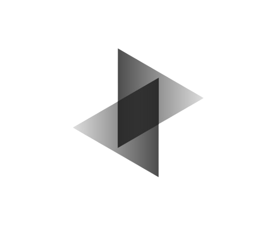

  

# We are Team Tangible
We are Designing new ways to control and use the power of robotics and AI for the better. We create projects with the focus of making sure it packs power while being easy for the end user
## Our projects
### SAVA
SAVA (Semi-Autonomus Vehicles for All) is a software for controlling multiple vehicles like Rovers, Robo Dogs, UAV, Rockets, Speedboats, Submarines and more. We belive in the fundimental that when someone uses SAVA they can view a huge area without having to go to that area and perform anything else themselves.